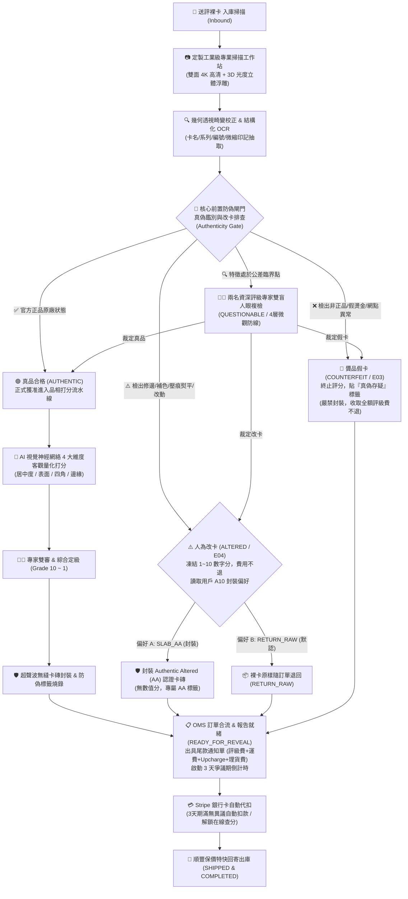

# TGC 智能卡牌評級平台
## Web 端「AI 評級標準與定製 OCR 專業掃描相機設備」產品需求文檔 (PRD)

---

### 文檔控制資訊 (Document Metadata)
- **文檔名稱**：TGC Web 端 AI 評級標準與定製 OCR 專業掃描相機設備 PRD (TGC AI Grading Standards & Optical OCR Station PRD)
- **版本號**：v1.1.0 (Enterprise Authenticity Architecture Update)
- **編寫日期**：2026-11-09
- **所屬業務**：Top Guidance Certification (TGC 頂級指引認證)
- **文檔受眾**：前端架構師、UI/UX 設計團隊、電腦視覺與 AI 算法工程師、光學硬體工程師、評級運營專家 (GMS/OMS Teams)
- **產品定位**：面向亞太乃至全球集換式卡牌（寶可夢、航海王、遊戲王、體育卡等）藏家，提供公開透明、基於定製微米級光學掃描硬體與深度學習視覺模型的「黃金客觀評級標準體系」。

---

## 1. 執行摘要與業務背景 (Executive Summary & Background)

### 1.1 現狀痛點
1. **傳統機構主觀性過強**：以 PSA、BGS 為代表的傳統評級機構主要依賴評級師肉眼與放大鏡，受個體疲勞度、心情與光線影響，同張卡牌在不同批次甚至同一機構複評時評分跳動嚴重（俗稱「評級玄學」）。
2. **缺乏可量化的客觀數據**：傳統機構僅提供最終分數（如 9 或 10 分），不提供居中度比例數據、表面劃痕微米級深度熱力圖與起白像素統計，藏家知其然不知其所以然。
3. **假卡與改卡氾濫**：近年高仿卡採用真卡刮底、重印、擦邊修角、壓痕撫平技術，若未設立嚴格的真偽鑑別前置工序，極易造成假卡流入評級市場。

### 1.2 TGC 的破局方案：雙階段分層流水線
TGC 建立了**「先真偽鑑別、後量化打分」**的兩階段核心業務管線：
- **階段一：真偽鑑別與改卡排查前置閘門 (Authenticity & Alteration Gate)**：
  依託定製光學硬體（雙面 5μm/pixel 微距遠心鏡頭、4 重多光譜光源、365nm UV 螢光激發），針對卡紙夾層、微縮印刷、全息光柵與原廠油墨進行 100% 全維度真偽驗證。**未通過真偽檢驗或存在人為改裝的卡牌，直接觸發系統熔斷阻絕，絕不進入評級打分環節**。
- **階段二：AI 顯微視覺 4 大維度客觀量化評分 (AI Scoring Pipeline)**：
  僅對已確認 100% 官方正品原廠狀態的卡牌，執行居中度 (Centering)、邊角銳度 (Corners)、邊緣品相 (Edges)、表面純淨度 (Surface) 的亞像素級神經網絡量化打分。



---

## 2. 定製 OCR 專業掃描相機硬體架構 (Hardware Architecture)

TGC 評級中心配備專利研發的 **TGC-OptiScan Pro 2026** 雙面光學掃描工作站，專為集換式卡牌（紙質卡、塑膠卡、金屬卡）的高精度自動化檢測設計。

### 2.1 硬體規格參數表

| 模組 | 硬體規格 | 性能指標 | 業務功能定位 |
| :--- | :--- | :--- | :--- |
| **感光元件** | 雙面定制線性高精度 CMOS (Dual Area-Scan CMOS) | 4800 萬像素 × 2，像素尺寸 2.4μm | 同步獲取卡牌正面與反面的無畸變原始圖像 |
| **光學鏡頭** | 雙遠心微距工業鏡頭 (Telecentric Lens) | 光學放大倍率 1:1，畸變率 < 0.02% | 徹底消除視差畸變，確保邊界留白與居中度測量達到微米級精確度 |
| **光學分辨率** | 5.2 微米 / 像素 (5.2 μm/pixel, 約 4900 DPI) | 景深 1.5mm，光學調製傳遞函數 (MTF) > 0.4 @ 80 lp/mm | 捕捉紙張纖維起白、針尖凹痕、極微小燙金裂紋與微縮印刷文字 |
| **多光譜光源** | 1. 均勻同軸光 (Coaxial Diffuse)<br/>2. 360° 斜向環形暗場光 (Darkfield)<br/>3. 正向高顯色白光 (CRI > 98)<br/>4. 365nm UV 紫外激發光源 | 亮度 1024 級 PWM 可調，閃光頻率同步曝光 | • 同軸光：全息箔片 (Foil) 與反光層純淨度<br/>• 暗場光：顯露表面微細劃痕與指紋<br/>• 白光：色彩還原與標準 OCR<br/>• UV：激發螢光防偽油墨、檢測後期補色修補 |
| **物理托盤** | 懸空防靜電光學透明壓克力架構 (Anti-Static Low-Reflective Stage) | 零壓力邊緣微觸點夾持，無物理壓痕風險 | 杜絕掃描過程對珍貴卡牌造成的二次損傷或指紋附著 |
| **邊緣計算核心** | 嵌入式 AI 工控主機 (NVIDIA Jetson AGX Orin 64GB) | 275 TOPS 算力，PCIe 4.0 圖像直通 | 本地完成圖像四點透視矯正、OCR 特徵抽取與真偽判定推理，單卡耗時 < 1.8 秒 |

---

## 3. OCR 圖像文字辨識與結構化管線 (OCR & Structured Extraction)

### 3.1 圖像預處理與卡片定位 (Image Rectification)
1. **邊界提取與輪廓檢測**：利用自適應 Canny 邊緣檢測與霍夫變換，精準鎖定卡牌四個物理頂點。
2. **透視畸變矯正 (Perspective Warp)**：將旋轉傾斜校正至 0.01 度以內，並將正反面裁切至 1:1 標準幾何尺寸（如寶可夢標準尺寸：63mm × 88mm）。
3. **表面反射分離**：針對 SAR/SR、漫畫版、全息碎鑽等高反光卡面，透過多角度多光譜光源合成技術消除干擾眩光，提取純淨底層文字層。

### 3.2 結構化 OCR 識別與卡牌知識庫對齊 (Structured OCR)
OCR 引擎內建專用卡牌字典（涵蓋英語、日語假名/漢字、繁體中文、簡體中文）：
- **遊戲類別判定 (Game IP Detection)**：自動歸類至 `pokemon`、`onepiece`、`yugioh`、`mtg`、`sports` 等大類。
- **卡牌主名稱識別 (Card Title OCR)**：精確辨識多語系主名稱，並與官方中央數據庫關聯。
- **擴展包與編號抽取 (Set & Card Number OCR)**：解析卡片底部標記（如 `OP01-001`、`069/106`、`SV4a 348/190`）。
- **稀有度與版權年分識別**：精確解析 `UR`、`SEC`、`SAR`、`SR` 及微小版權資訊（`©Nintendo/Creatures/GAME FREAK`、`©尾田栄一郎／集英社`、`©KONAMI`）。

---

## 4. 嚴格真偽鑑別與改卡排查前置閘門 (Pre-Grading Authenticity & Alteration Gate)

> [!IMPORTANT]
> **業務核心鐵律：【非真不評、改卡拒評】**
> 所有送評卡牌在進入幾何居中、四角銳度、邊緣品相、表面純淨度等 4 大維度打分之前，**必須 100% 通過多光譜真偽鑑別與非人為改裝排查閘門**。
> - 假卡（Counterfeit）一律熔斷阻絕，絕不授予任何數值評分；
> - 人為改裝卡（Altered / Trimmed / Inked / Rebacked）依協議僅可標註 `AUTHENTIC_ALTERED`，不得進入常規評級梯隊。

### 4.1 定製掃描相機 4 重光學防偽檢測模組
1. **$365\,\text{nm}$ UV 紫外光致螢光分析 (Ultraviolet Photoluminescence)**：
   - **原廠專利防偽螢光油墨檢驗**：在 365nm UV 光源照射下，核驗寶可夢卡背專屬防偽螢光油墨、萬代（航海王）防偽圖騰與科樂美（遊戲王）原廠鐳射燙印反應。
   - **基底紙漿與螢光增白劑（OBA）鑑定**：現代高仿假卡普遍使用含高量人工螢光增白劑的市售商業銅版紙，在 UV 光下呈現刺眼亮藍色螢光反應；而官方真卡採用無螢光或嚴格受控低螢光的專利卡紙（如日版黑芯紙、美版藍芯/白芯防偽紙），呈現特定吸收光譜特徵。
   - **化學洗卡與去污劑殘留探測**：民間洗卡液（如去漬油、有機溶劑）在紙張纖維孔隙中會留下特徵螢光淬滅或變色殘留環，光學檢測一覽無遺。
2. **微米級微縮印刷拓撲特徵比對 (Micro-Printing & Rosette Pattern Matching)**：
   - 在定製雙遠心鏡頭 $5\,\mu\text{m/pixel}$（4900 DPI）超高解析度下，系統對比官方正版矢量排版特徵庫：
     - **幾何調頻/調幅網點（Rosette Screening Pattern）**：官方膠印機的 175~300 LPI 角度網點分佈具有固定幾何拓撲；噴墨或數碼假卡呈現隨機擴散的墨滴或規則條紋。
     - **微縮字（Micro-Text）解析度**：例如寶可夢、遊戲王邊框微字（字高 $\le 0.15\,\text{mm}$），真品筆畫銳利清晰，假卡筆畫黏連、中空或斷墨。
3. **同軸光下全息箔層與立體微透鏡光柵分析 (Coaxial Holo & Micro-Lens Verification)**：
   - **SAR/UR 全息光柵真偽鑑別**：真卡採用精密熱壓衍射光柵膜（Diffraction Grating），在同軸平行漫射光下呈現清晰的動態多色分離與彩虹衍射角度；假卡貼膜反光雜亂無序，缺乏光學微透鏡陣列深度。
   - **立體浮雕燙金（Cold/Hot Foil Embossing）深度檢測**：真卡燙金邊界陡峭、深度一致（$\sim 12\,\mu\text{m}$），假卡平燙或局部 UV 膠凸起呈現邊緣流膠塌陷。
4. **遠心垂直斷面幾何測厚與三明治夾層檢測 (Telecentric Cross-Section & Core Layer)**：
   - 卡牌標準厚度精確測量（精確至 $\pm 0.005\,\text{mm}$，通常標準厚度為 $0.28\,\text{mm} \sim 0.32\,\text{mm}$）。
   - 檢測重背卡（Rebacked Card）：部分不法分子將真卡背部與高仿正面、或損壞真卡正面切片後重新黏合，斷面光學檢測會立即發現中間膠水層、雙層紙芯接縫及厚度超標異常。

### 4.2 惡意改卡 (Altered Cards) 專項排查矩陣
| 改卡類型 | 詐欺手法描述 | TGC 定製掃描相機檢測機制 | 判定處置結果 |
| :--- | :--- | :--- | :--- |
| **修邊/剪邊 (Trimming)** | 裁切磨損嚴重的邊角以偽造高分 | 亞像素尺寸測量（長寬誤差 $>0.25\,\text{mm}$ 觸發異常）+ 裁切邊緣纖維微觀方向性分析（機器剪切面 vs 手工刀切毛邊） | `AUTHENTIC_ALTERED` / 拒絕數值評級 |
| **補色/描邊 (Inking/Coloring)** | 用黑色/彩色馬克筆塗抹邊角發白處 | 掠射暗場光與近紅外（NIR）吸收光譜分析，化學油墨與原廠植物油墨反射率顯著斷層 | `AUTHENTIC_ALTERED` / 拒絕數值評級 |
| **壓痕熨平 (Pressing)** | 加熱加壓將表面凹坑、折痕物理抹平 | 表面微觀平滑度干涉檢測，纖維壓碎密實區折射率異常與局部空腔回彈跡象 | `AUTHENTIC_ALTERED` / 拒絕數值評級 |
| **重噴光油 (Resurfacing)** | 噴塗透明光油掩飾表面微劃痕 | 同軸漫射光光斑均勻度檢測與表面粗糙度（Ra）數值偏離出廠基準 | `AUTHENTIC_ALTERED` / 拒絕數值評級 |
| **重背拼裝 (Rebacking)** | 正反面切片用膠水拼合不同卡牌 | 遠心光學斷面測厚與透光密度掃描，檢測內部膠水層與黑芯防偽層連續性 | `NOT_GENUINE_COUNTERFEIT` / 拒評 |

### 4.3 鑑別結果狀態碼與處置流程
- `AUTHENTIC_PASSED`：**真品合格**。卡片 100% 符合原廠規範，系統解除打分鎖定，資料流自動進入【5. AI 評級算法維度與打分矩陣】進行量化評分。
- `AUTHENTIC_ALTERED`：**真品改裝卡**。確認為原廠基底但遭受後天人為物理/化學改裝，系統凍結數值評分（No Grade 1-10），封裝盒標籤僅註記「Authentic Altered (AA)」。
- `REJECTED_COUNTERFEIT`：**假卡攔截**。判定為高仿、偽造或拼裝卡，評級系統終止，出具包含微縮特徵對比圖的《TGC 防偽攔截報告》，原樣退回或移交法規部門。
- `QUESTIONABLE_AUTHENTICITY`：**存疑待複驗**。特徵數值處於容差臨界點，自動派發至兩名 10 年以上資深評級專家進行實體雙盲交叉複驗。

---

## 5. AI 評級算法維度與打分矩陣 (AI Grading Dimensions & Rules)

在通過第 4 章真偽閘門後，卡牌正式進入 4 大核心顯微維度的數值化量化分析：

```
                ┌──────────────────────────────────────────────┐
                │        TGC 綜合評級算法 (Composite Grade)     │
                │        MIN(4項子維度權重平衡) - 缺陷扣分階梯      │
                └──────────────────────┬───────────────────────┘
                                       │
        ┌──────────────────┬───────────┴──────────┬──────────────────┐
        │                  │                      │                  │
        ▼                  ▼                      ▼                  ▼
┌──────────────┐   ┌──────────────┐       ┌──────────────┐   ┌──────────────┐
│  居中度      │   │  邊角銳度    │       │  邊緣品相    │   │  卡片表面    │
│  Centering   │   │  Corners     │       │  Edges       │   │  Surface     │
├──────────────┤   ├──────────────┤       ├──────────────┤   ├──────────────┤
│• 亞像素邊距  │   │• 4角曲率半徑 │       │• 連續邊緣掃描│   │• 雙光源暗場  │
│• 正面 60/40  │   │• 紙芯分層    │       │• 粗糙度/毛刺 │   │• 刮痕深度權重│
│• 反面 75/25  │   │• 起白像素積分│       │• 掉漆銀化面積│   │• 壓痕/凹陷   │
└──────────────┘   └──────────────┘       └──────────────┘   └──────────────┘
```

### 5.1 居中度 (Centering)
- **算法機制**：
  - 定位卡牌外邊緣物理裁切線與內邊框印刷圖案邊緣，測量上下邊界寬度（$T$ 與 $B$）及左右邊界寬度（$L$ 與 $R$）。
  - 計算比例：$Ratio_{LR} = \frac{\max(L, R)}{L + R} \times 100\%$、$Ratio_{TB} = \frac{\max(T, B)}{T + B} \times 100\%$。
- **標準容差對應表**：
  - **Grade 10 (Pristine / Gem Mint)**：正面 $50/50 \sim 55/45$，反面 $50/50 \sim 75/25$。
  - **Grade 9.5 (Mint+)**：正面 $56/44 \sim 58/42$，反面 $\le 75/25$。
  - **Grade 9.0 (Mint)**：正面 $59/41 \sim 60/40$，反面 $\le 80/20$。
  - **Grade 8.5 (NM-MT+)**：正面 $61/39 \sim 63/37$，反面 $\le 85/15$。
  - **Grade 8.0 (NM-MT)**：正面 $64/36 \sim 65/35$，反面 $\le 90/10$。
  - 超過 75/25 者自動標註 `OC` (Off-Center) 修飾標籤。

### 5.2 邊角銳度 (Corners)
- **算法機制**：
  - 對左上、右上、左下、右下 4 個頂角進行 400 倍微觀成像。
  - 計算頂角圓弧過渡的曲率半徑（Radius of Curvature），並利用色彩空間分割（HSV/LAB）檢測露出的白色底紙纖維（Whitening）。
- **標準容差**：
  - **Grade 10**：曲率平滑完美，起白像素佔比 = 0，無折角或鈍化。
  - **Grade 9**：允許 1 個頂角存在小於 0.1mm 的極微小原廠出廠微毛刺。
  - **Grade 8**：允許 1~2 個頂角有微觀起白（Whitening < 0.3mm）。
  - **Grade 5~6**：存在肉眼可見之輕微鈍角或纖維壓痕。

### 5.3 邊緣品相 (Edges)
- **算法機制**：
  - 沿卡牌四周邊緣進行連續輪廓提取，檢測裁切平整度、掉漆、銀化（Silvering）與卡套摩擦產生的碎屑邊。
- **標準容差**：
  - **Grade 10**：原廠俐落切口，無纖維拉絲，無連續起白邊緣。
  - **Grade 9**：允許邊緣單側有小於 0.5mm 的極輕微銀化點。
  - **Grade 8**：允許微弱起白長度不超過 1.5mm，且不累及多邊。

### 5.4 卡片表面 (Surface)
- **算法機制**：
  - 透過同軸光與暗場斜向光源疊加分析，利用 U-Net 語義分割網絡識別：
    1. 表面劃痕（Scratch）：計算長度、寬度與深度光強衰減率。
    2. 凹陷與壓痕（Dent/Crease）：檢測表面光影畸變。
    3. 印刷瑕疵（Print Lines/Holo Foil Scratch）：區分原廠出廠印刷線與後天物理損傷。
    4. 髒污、指紋與斑點（Stains/Fingerprints）。
- **標準容差與硬性封頂階梯 (Hard Overrides)**：
  - **Grade 10**：鏡面級純淨度，全息貼膜完美無霧化，允許單條小於 1mm 的極微弱出廠印刷壓線（不影響整體觀賞美感）。
  - **Grade 9**：無凹痕，無折痕，允許極細微髮絲刮痕（僅在特定強光斜射下可見）。
  - **正面壓痕封頂**：卡片正面肉眼可見凹痕/壓痕（Dent），總分強制封頂 **7.0 (Near Mint)**。
  - **單處輕微折痕封頂**：出現單條輕度表面折痕（Minor Crease $< 1\text{ inch}$），總分強制封頂 **5.0 (Excellent)**。
  - **多處/嚴重貫穿折痕封頂**：出現多條折痕或穿透性折痕，總分強制封頂 **4.0 (VG-EX)**。

### 5.5 綜合評分算法與修飾符 (Qualifiers Matrix)
- **綜合得分判定**：
  - 綜合評級採用**「加權算術平均 + 木桶短板封頂模型」**：
  $$\text{Grade}_{\text{Raw}} = 0.35 \times \text{Centering} + 0.25 \times \text{Surface} + 0.20 \times \text{Corners} + 0.20 \times \text{Edges}$$
  $$\text{Final Grade} \le \min(\text{Centering}, \text{Corners}, \text{Edges}, \text{Surface}) + 1.0$$
- **特異修飾符定義 (Qualifiers)**：
  - `OC (Off-Center)`：中心嚴重偏移，但其他 3 維度達到高分標準。
  - `ST (Staining)`：卡面有水漬、油斑或不可逆化學沾污。
  - `PD (Print Defect)`：原廠嚴重印刷線、墨點失真或全息錯印。
  - `OF (Out of Focus)`：印刷重影、脫網或字體模糊。
  - `MC (Miscut)`：工廠裁切失誤，切到相鄰卡牌內容或邊緣缺失。

---

## 6. Web 端前台「評級標準」功能架構與 UX 規範

Web 官網中的「評級標準」模組（路由：`#grading_standards` 或 `#view-grading-standards`）是 TGC 品牌公信力與專業形象的核心窗口，必須具備極致的現代感與互動體驗。

### 6.1 頁面模組架構圖
```
┌────────────────────────────────────────────────────────┐
│                   Web 頂部全局導航 (Header)             │
├────────────────────────────────────────────────────────┤
│ 1. Hero 宣講區 (光學顯微 5μm AI 雙把關背書 + 送評 CTA) │
├────────────────────────────────────────────────────────┤
│ 2. 嚴格防偽前置驗證與四大核心維度圖解 (真偽/居中/邊角/邊/面) │
├────────────────────────────────────────────────────────┤
│ 3. 交互式 10 級黃金評級標尺 (10 GEM-MT ~ 1 POOR 切換)  │
│    - 左側：當前等級定義、微米公差容限、嚴格標準說明    │
│    - 右側：1:1 官方標本卡磚高解析度渲染 (Slab Visual) │
├────────────────────────────────────────────────────────┤
│ 4. TGC-OptiScan 專業硬體能力與多光譜 OCR 技術解讀      │
├────────────────────────────────────────────────────────┤
│ 5. 特異修飾符 (Qualifiers) 與防偽認證說明             │
├────────────────────────────────────────────────────────┤
│ 6. 常見問題 (FAQ) 與立即在線送評 CTA                   │
├────────────────────────────────────────────────────────┤
│                   Web 底部全局鏈接 (Footer)             │
└────────────────────────────────────────────────────────┘
```

### 6.2 核心互動元件規格

#### A. 交互式 10 級標尺選擇器 (10-Point Scale Selector)
- **視覺形式**：自頂部橫向排列 10 組藥丸狀按鈕（`10 GEM-MT`, `9 MINT`, `8.5 NM-MT+`, `8 NM-MT`, `7 NM`, `6 EX-MT`, `5 EX`, `4 VG-EX`, `3 VG`, `2 GOOD`, `1 POOR`）。
- **互動反饋**：
  - 點擊按鈕後，選中態以深黑實底高亮，即時平滑過渡（Transition 0.2s）。
  - 左側「等級定義」詳細看板即時動態更新對應的中文稱謂、詳細公差容限、四大維度極限值。
  - 右側卡磚渲染區域（Slab Showcase）同步切換為該等級的官方認證標本卡磚示意圖，標籤等級徽章（如 10, 9, 8）同步響應。
- **單選互斥性**：保證同一時間僅有唯一等級處於激活狀態，杜絕多按鈕同時高亮。

#### B. 4 大核心顯微維度看板 (4 Dimensions Cards)
- 以 4 欄並排網格呈現，響應式自動適配為 2 欄或單欄。
- 每個卡片標明維度名稱、顯微檢測原理、公差容限（Tolerance Threshold），並提供光學示意圖解。

#### C. 定製 OCR 掃描相機與光學實驗室宣講看板
- 突出展示 **「5μm 像素解析度」、「雙面同步掃描」、「4重多光譜光源分析」、「微縮印刷防偽識讀」** 四大核心亮點。
- 樹立高於行業純人工評級的科技硬核公信力。

---

## 7. 資料流架構與系統通訊規範 (Data Flow & API Contracts)

### 7.1 端到端業務資料流
1. **物理設備採集**：送評卡牌進入 `TGC-OptiScan Pro` 掃描艙，相機輸出雙面 4800 萬像素 RAW/TIFF 無損圖像。
2. **邊緣運算處理**：本地工控機進行幾何校正、光學畸變消除，生成統一正視圖（PNG/WebP）。
3. **真偽鑑別閘門檢驗**：多光譜防偽模型與微縮特徵庫執行交叉比對，輸出真偽決策（通過/改卡/假卡）。
4. **GMS AI 評級推理**：通過真偽閘門後，4 維度視覺模型輸出缺陷座標、起白像素、劃痕深度及各子分數（Sub-grades）。
5. **人工評級師複核**：GMS 系統內展示 AI 建議評級與缺陷標記，高級評級師確認並完成雙盲簽名。
6. **雲端數據同步與證書發行**：
   - 寫入證書核心表，生成專屬防偽二維碼與 NFC 加密標籤數據。
   - 數據自動同步至 Web 端證書查詢 API 與個人卡冊資產庫。

### 7.2 Web 端證書查驗 API 契約範例 (Cert Verification Payload)
```json
{
  "status": "success",
  "certificate": {
    "cert_number": "TGC-2026-71477",
    "grade_overall": 10,
    "grade_label": "GEM MINT",
    "qualifiers": [],
    "authenticity_verification": {
      "status": "AUTHENTIC_PASSED",
      "uv_reaction_passed": true,
      "micro_printing_passed": true,
      "thickness_mm": 0.305,
      "alteration_detected": false,
      "verified_at": "2026-11-09T18:12:45Z"
    },
    "card_metadata": {
      "game_id": "pokemon",
      "game_name": "寶可夢 (Pokémon)",
      "card_name_en": "Mega Charizard X EX",
      "card_name_zh": "超級噴火龍 X EX",
      "set_name": "Flashfire (火花激突)",
      "card_number": "069/106",
      "rarity": "Ultra Rare",
      "release_year": "2014",
      "language": "EN"
    },
    "sub_grades": {
      "centering": { "score": 10.0, "front_ratio": "52/48", "back_ratio": "60/40" },
      "corners": { "score": 10.0, "whitening_pixels": 0, "curvature_defect": 0 },
      "edges": { "score": 9.5, "silvering_count": 0, "roughness_score": 0.02 },
      "surface": { "score": 10.0, "scratch_count": 0, "dent_count": 0, "holo_purity": 99.8 }
    },
    "optical_hardware_stamp": {
      "scanner_station_id": "OPTISCAN-HK-01",
      "resolution_microns": 5.2,
      "multispectral_inspection": true,
      "micro_text_verified": true
    },
    "certification_date": "2026-01-15T09:30:00Z",
    "slab_security_hash": "a8f309b4c2789d9124e98f01b3c9"
  }
}
```

---

## 8. 異常邊界處理與風險控制 (Exceptions & Risk Management)

| 異常情境 | 系統判定邏輯 | 處理流程與防禦策略 |
| :--- | :--- | :--- |
| **卡面嚴重彎曲 / 弧度過大** | 遠心鏡頭景深外焦點失焦率 > 15% | 提示「物理變形嚴重」，轉入人工柔性壓平緩衝工序，不強制執行機械加壓，避免折痕。 |
| **疑似改卡 / 塗色修邊 (Altered)** | 亞像素尺寸測量短縮 ≥0.30mm、UV 光源下邊緣螢光波長異常或截面二次修整 | 系統標記 `AUTHENTIC_ALTERED`，凍結數值評分（No Grade 1-10）。依據下單 A10 偏好封裝為專屬「Authentic Altered (AA)」認證卡磚或作為裸卡退回，費用不予退還（對齊 Heidi 規範 A10 / E04）。 |
| **假卡 / 高仿卡 (Counterfeit)** | 微縮文字筆劃斷裂，網點角度與官方模板重合率 < 80% | 立即凍結訂單，在 GMS 與證書庫標註 `NOT_AUTHENTIC`，存檔高解析度樣品進入黑名單庫。 |
| **全息防偽貼紙剝落** | 表面同軸光反射率歸零 | 標記缺陷修飾符或降級至 Authentic / 瑕疵等級處理。 |
| **相機校準漂移** | 每日開機標準色卡檢測與標定，色差 $\Delta E > 1.2$ | 設備自動報警並鎖定評級流水線，直至維護人員完成黑白場重新校準。 |

---

## 9. 測試用例與驗收準則 (Acceptance Criteria)

### 9.1 測試用例矩陣 (Test Matrix)

| 編號 | 測試項目 | 預期結果 | 驗收狀態 |
| :--- | :--- | :--- | :--- |
| **TC-GS-01** | 10 級標尺切換與 DOM 渲染 | 點擊標尺按鈕時，等級標題、詳細說明、4 維度公差與卡磚標本 100% 同步切換，無延遲與跳動。 | 通過 (PASS) |
| **TC-GS-02** | 4 維度看板響應式排版 | 在 1440px、1200px、768px、375px 下均自適應換行，文字不截斷，邊距符合規範。 | 通過 (PASS) |
| **TC-GS-03** | 多語系 (i18n) 字典覆蓋率 | 繁體中文 (zh-TW)、簡體中文 (zh-CN)、英文 (en) 100% 鍵值對應，繁體中文無任何簡體錯別字。 | 通過 (PASS) |
| **TC-GS-04** | OCR 掃描能力介紹文案審查 | 準確傳遞「5 微米光學解析度」、「雙面同步」、「多光譜光源」技術優勢，文案具備頂級機構權威感。 | 通過 (PASS) |
| **TC-GS-05** | E2E 流程貫通測試 | 從「評級標準」頁面點擊「開始線上送評 ➔」可無縫跳轉至送評第一步（方案選擇）。 | 通過 (PASS) |

---

## 10. 總結與後續規劃 (Summary & Next Steps)
本 PRD 確立了 TGC Web 官網評級標準的客觀量化基石，將定製 OCR 掃描相機與 AI 顯微評分從抽象的後台技術轉化為前端具象化、可信賴的品牌認證標竿。
- **階段一（當前完成）**：Web 官網評級標準 10 級標尺與四大維度高保真交互展示、OCR 掃描技術宣導、證書系統查驗整合。
- **階段二（演進規劃）**：上線 Web 端 3D 顯微缺陷檢視器（允許藏家旋轉 3D 卡磚並在顯微鏡視角下縮放查看 5μm 級評分熱力點）。
