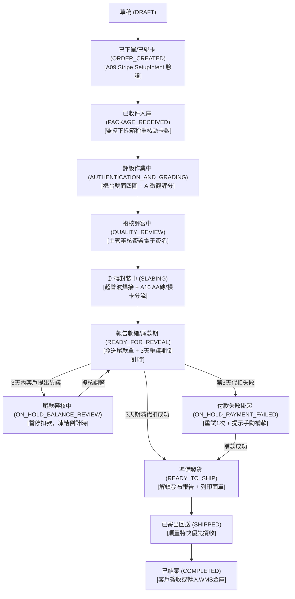

# TGC OMS（訂單管理系統）MVP 版本產品需求文件 (PRD)

> **所屬體系**：TGC (The Good Cherry / 櫻桃未來) 綜合營運中台  
> **關聯系統代碼**：`cms/frontend/cms.html` · `cms/services/cms_db.js` · `shared/card_db/orders_db.js` · `server.js` · `web/frontend/index.html`  
> **預設語言體系**：**English (en)** 與 **繁體中文 (zh-TW)** 雙語支援  
> **基礎規格來源**：《評級送評：異常情況處理規範》（PM: Yiu Heidi，最後更新：2026年11月11日）  
> **角色與權限**：**Super Admin / Ops Manager / Grader** 三級職能協同體系  

---

## 1. 文檔定位與系統邊界

### 1.1 系統定位
OMS (Order Management System) 作為 TGC 綜合營運中台（CMS）與客戶終端（Web / App）的全局調度與履約中樞：
* **對上（客戶端）**：接收 Web 官網門戶（`web/frontend/index.html`）與 移動端 App（`app/frontend/app.html`）提交的送評訂單、A10 改卡封裝偏好（`altered_action_preference`）、Stripe 綁卡預授權（`CARD_ON_FILE`）與在途物流信息。
* **對下（實驗室與營運）**：與 GMS（評級工作台 `gms.html` / `gms_workflow.js`）及 Pricing Engine（公允估值與匯率引擎）無縫打通，協同處理拆包入庫（`PACKAGE_RECEIVED`）、少卡/多卡異常攔截、出分後尾款通知單（Balance Notice）發布、3天爭議期管控、Stripe 尾款自動代扣、綜合評級報告發布與順豐保價回寄發貨。

### 1.2 核心業務原則
1. **以「訂單（Order）」為全局財務與履約主體**：財務扣款、物流包裹、客戶通知均以 Order 為主體；報告以訂單為單位交付，內部掛載各單卡（Card Item）的獨立評級報告。
2. **單一真實數據源 (Single Source of Truth)**：Web 官網、移動 App 與 CMS 中台狀態 100% 依據 OMS 核心訂單記錄為準。
3. **查分鎖死機制（Score Gating）**：在尾款完全付清前，評級分數嚴格保持鎖定（Gated），客戶端僅能查閱費用明細，杜絕“看低分惡意拒付尾款”的違約行為。
4. **全額港幣結算**：所有訂單尾款必須以港幣（HKD）一次性全額扣除，絕不允許拆分支付。

---

## 2. 角色與權限架構 (RBAC)

OMS 構建三級權限協同矩陣（對齊 CMS/GMS 工作台操作員體系）：

1. **`Super Admin`（超級管理員 / 系統總控）**：
   * **代表賬號**：`admin@tgc.com` / `cms-super-admin`
   * **管轄邊界**：全域狀態總控（拆包入庫 `PACKAGE_RECEIVED`、放行出庫 `SHIPPED`、結案歸檔 `COMPLETED`）、尾款爭議（F10）仲裁、Stripe 手動扣款/退款、物流打單與 90 天棄卡處置裁決。
2. **`Ops Manager`（運營主管 / 終審經理，如 Sara Chang）**：
   * **管轄邊界**：GMS 批次完成雙人電子簽名（Review & Sign）、外殼超聲波焊接質檢（Slab QC Approved）、拆箱少卡/多卡錄像核實、異常工單初審。
3. **`Grader`（認證評級師，如 Tom Lee / Mary Kim）**：
   * **管轄邊界**：GMS 定制機台光學拍照（雙面四圖）、微觀網點/黑芯真偽鑑定、瑕疵邊界標註與 AI 初評覆核。

---

## 3. 核心支付模式：Stripe 綁卡預授權與 3 天爭議期（規範第 0 部分）

### 3.1 支付模式規則表

| 規則說明 | 決策狀態 |
| :--- | :--- |
| **下單強制綁卡**：在提交（Submit）之前，客戶需輸入支付信息：直接輸入信用卡或借記卡，或通過 Apple Pay 或 Google Pay 綁定。該卡通過 Stripe 保存並與該訂單綁定。若無有效銀行卡，則無法提交訂單。 | 已決定 |
| **默認預填**：該銀行卡同時會保存到賬戶中。未來的訂單將默認預填該卡，客戶也可以在訂單中更改。 | 已決定 |
| **訂單卡獨立性**：客戶可在“賬戶（Account）”頁面管理已保存的銀行卡。此處的更改不會影響任何已提交的訂單。每個訂單均保留其提交時所綁定的銀行卡。 | 已决定 |
| **結賬協議告知**：結賬頁面會告知客戶該卡將被保存以供未來訂單使用，且 TGC 將從該卡中扣除本訂單的尾款（balance）、任何補差價（up-charge）以及任何通知單費用（notice fees）。 | 建議（措辭：待法務審閱） |
| **Stripe 卡生命週期**：從賬戶中移除銀行卡僅會使其不再預填。該卡會繼續保留在 Stripe 中，直到使用該卡的所有訂單均已結案，隨後才會被徹底移除。 | 建議（工程團隊） |
| **訂單換卡**：客戶可以在訂單詳情頁面更改已提交訂單的綁定卡。此操作僅影響該筆訂單。 | 建議 |
| **提交時 0 元扣款**：提交訂單時不進行扣款。Stripe 會在保存銀行卡時驗證其有效性（SetupIntent 預授權校驗）。 | 已決定 |
| **出具尾款通知單**：當“報告就緒（Report ready）”時，TGC 會發送尾款通知（balance notice）。其中會列出每一項明細：基礎評級費、附加服務費（add-ons）、額外包裹費、評級後調整費（補差價 Upcharge）及其原因、退貨運費和 SPP，以及以港幣（HKD）計價的總金額。同時還會註明銀行卡的預定扣款日期。 | 已決定 |
| **3 天爭議期**：客戶可在收到尾款通知後的 3 天內對尾款金額或補差價提出異議。若無異議，則在 3 天期滿後自動從訂單綁定的銀行卡中代扣全款。扣款成功後將發布評級報告並解鎖查分。 | 已決定 |
| **爭議期邊界**：該爭議期僅用於對尾款（金額、補差價、各項費用）提出異議。評分結果仍將在付款後發布，並按 E08 條款處理評分爭議。 | 建議（對決策的解讀） |
| **本地支付作為補付款兜底**：轉數快（FPS）、Alipay HK 和 WeChat Pay 通常無法保存以供後續自動扣款。這些支付方式僅在訂單綁定的銀行卡扣款失敗後，提供給客戶用於主動補款。 | 建議（Stripe HK：待工程團隊確認） |
| **一次性全額清償**：尾款需一次性全額支付，絕不拆分，以港幣（HKD）結算。 | 已決定 |
| **通知單即時扣款**：通過通知單計費的各項費用（關稅、重新派送費、退回通知費、重新寄送費）將在通知單發出時直接從訂單綁定的銀行卡中扣除。 | 建議 |

### 3.2 尾款通知發出後的支付時間線（第 0 天起算）

| 天數 (Day) | 核心事件與狀態流轉 | 業務動作與通知機制 |
| :---: | :--- | :--- |
| **0** | 發送尾款通知（包含扣款日期），開啟 3 天爭議期。 | 訂單進入 `READY_FOR_REVEAL`，狀態標記為 `BALANCE_DUE`。評級分鎖死。 |
| **1** | 提醒：將於第 3 天從銀行卡扣款。 | 系統發送 Email / Push 倒計時提醒。 |
| **3** | **爭議期結束**。若無異議，則從訂單綁定的銀行卡扣款。<br>• **扣款成功**：發布報告解鎖查分，訂單狀態變更為“準備發貨 (`READY_TO_SHIP`)”。 | 呼叫 Stripe PaymentIntent 執行扣款，自動生成財務收據。 |
| **3–4** | **扣款失敗**：訂單進入“暫停（付款失敗）[`ON_HOLD_PAYMENT_FAILED` / F01]”狀態，通知客戶，並自動重試扣款一次。 | 觸發二次代扣重試，發送付款異常通知。 |
| **5** | 提醒客戶更新銀行卡或主動付款。 | 開啟在線更換信用卡及 FPS / AlipayHK 主動補付款通道。**提醒中明確告知若逾期將於第 8 天起計收倉儲費**。 |
| **7** | **7 天付款期結束**。若仍未付款：**凍結客戶賬戶權限（E09 / G09）**。 | 卡牌移入金庫暫扣，凍結下單及查分權限。 |
| **8** | **倉儲費正式起算（F08）**。 | 自第 8 天起，按每日每卡 **HKD 1**（整單每日最低 **HKD 20**）按日累計計入尾款。 |
| **14, 21, 83** | 發送棄卡（放棄所有權）法定催告存證提醒。 | 發送具備法律效力的催繳郵件，警告逾期後果，**並在通知中列出截至當日的累計倉儲費**。 |
| **90** | **90 天法務期滿，客戶放棄卡牌所有權（G02）**。 | 卡牌法定所有權轉歸 TGC 所有，平台有權拍賣或銷毀，終身結案，不予退費。 |

### 3.3 官方定稿費用定價結構表 (Fee Structure 完整標準 · 對齊 2026/11/12 最新版)

| 費用項 (Fee Item) | 關聯規則 (Row) | 費率與計費標準 (Amount) | 計費依據與業務邏輯 (Basis) | 決策狀態 (Status) |
| :--- | :---: | :--- | :--- | :---: |
| **回寄運費與 SPP 保價** | 尾款 Balance | **順豐實際運費 + SPP 保價**（實報實銷） | 隨評級費在尾款中合併收取（Pass-through，對齊 PSA 慣例） | **已決定** |
| **退回通知單費用** | C10 | **順豐實際運費 + SPP 保價**（實報實銷） | 已取消訂單包裹退回，無尾款單，透過獨立通知單代扣 | 建議 |
| **重新寄送費** | D13 | **順豐實際運費 + SPP 保價 + HKD 20 處理費** | 包含實報實銷物流費與重新包裝打包工時工本 | 建議 |
| **額外包裹費** | C03 | **HKD 30 / 每個超出申報的包裹** | 超額包裹掃碼拆箱錄像、人工核驗與訂單卡片歸併工時 | 建議 |
| **亂序理貨費** | C06 | **訂單總評級費的 5%**（無免責容差，任何亂序即觸發） | 嚴苛對齊 PSA 國際慣例；工單移出常規流水線進入特檢處理 | **已決定** |
| **逾期倉儲費** | F08 | **每卡每日 HKD 1，整單每日最低 HKD 20**（自第 8 天起算） | 遏制惡意拖欠，彌補金庫庫位佔用；不設固定上限（受 90 天棄卡限制，最多計收 83 天） | **已決定（結構）**；金額待簽批 |
| **假卡 / 存疑卡評級費** | E03, E12 | **按訂單服務等級收取全額評級費，不予退款** | 實驗室已完整執行微距光學與四層防偽檢測；對齊 PSA 慣例 | **已決定 (E03)**；建議 (E12) |
| **人為改裝卡評級費** | E04 | **按訂單服務等級收取全額評級費，不予退款** | 檢驗工序已完成；貼專屬 Authentic Altered (AA) 標籤不加收額外費用 | **已決定** |
| **無法評級 / 嚴重翹曲** | E05, E13 | **不收取評級費**（裸卡原樣退回） | 超厚、預封裝、未拆封或翹曲無法成像，未執行實質評級打分 | **已決定 (E05)**；建議 (E13) |

---

## 4. 全生命週期狀態機規格 (Lifecycle & States)

### 4.1 主幹生命週期狀態流轉



### 4.2 異常掛起狀態代碼表 (On-Hold States)

| 狀態代碼 (`status`) | 業務名稱 | 觸發規則條款 | 解除條件與後續流轉 |
| :--- | :--- | :--- | :--- |
| `AWAITING_PARCEL` | 等待剩餘包裹 | C02（分批包裹部分未到） | 剩餘包裹送達後合併推進至 `PACKAGE_RECEIVED` |
| `ON_HOLD_INTAKE_MISMATCH` | 拆箱數量/卡片不符 | E01（少卡）, E02（多卡）, C03 | 客戶確認少卡索賠或確認追加多卡後恢復 |
| `ON_HOLD_BALANCE_REVIEW` | 尾款審核中 | F10（3天內對金額提出異議） | TGC 2 工作日複核，若更正重開 3 天期；若駁回 1 天後代扣 |
| `ON_HOLD_PAYMENT_FAILED` | 付款失敗掛起 | F01（第3天代扣扣款失敗） | 客戶更新卡片或主動透過 FPS 補款成功後恢復 |
| `ON_HOLD_ADDRESS_INVALID` | 回寄地址無效 | D10（回寄地址校驗未過） | 客戶在線確認有效香港地址後恢復 |
| `ORDER_FORFEITED` | 逾期90天棄卡沒收 | G02（滿90天失聯未付款） | 卡牌沒收歸平台處置，訂單終身結案 |

---

## 5. 全場景異常處置標準矩陣 (Exceptions Matrix A~H 完整規格)

### A. 訂單設置（提交前）

| ID | 異常情況 | 觸發條件 | 處理方式 | 客戶操作 / 費用 | 狀態 |
| :--- | :--- | :--- | :--- | :--- | :--- |
| **A01** | 混合服務等級 | 同一訂單中的卡牌具有不同的建議服務等級 | 按系統提供的建議等級拆分訂單，或由客戶更改服務等級。每個訂單僅限一個等級。在此之前無法提交。 | 拆分訂單或更改等級。無費用。 | 已決定 |
| **A02** | 卡牌價值超出等級保額上限 | 預估評級後價格（或兜底的市場價格）高於該服務等級的最高保額（max insured value） | 阻止提交。指明具體卡牌及限額。客戶需升級至更高服務等級、拆分訂單或移除該卡牌。 | 選擇一項操作。無費用。 | 已決定 |
| **A03** | 卡牌已在未結訂單中 | 收藏夾（Portfolio）中的藏品帶有“已提交評級（Submitted to grade）”徽章 | 無法添加該卡牌。徽章會顯示當前佔用該卡牌的訂單。 | 需先將其從另一訂單中移除。 | 已決定 |
| **A04** | 無法提供預估價 | 該卡牌沒有預估評級後價格 | 卡牌顯示其裸卡（raw）市場價格，並標註“市場價格（預估價不可用）[Market price (estimate unavailable)]”。可以添加並提交。服務等級建議及保額檢查均使用該價格。 | 無。 | 已決定 |
| **A05** | 提交後價格變動 | 提交後市場價格或預估價發生變化 | 提交時顯示的預估價對該訂單保持固定，服務等級也保持固定。僅當實際評級後的價值超出該等級的保額上限時，才適用補差價（up-charge）。 | 無（除非產生補差價）。 | 已決定 |
| **A06** | 草稿從未提交 | 訂單一直處於“未提交（Open）”狀態 | 不啟動發貨倒計時。草稿將一直保留，直到被提交或刪除。無操作滿 30 天後發送提醒。 | 無。 | 建議 |
| **A07** | 刪除或移動訂單中的卡牌 | 客戶嘗試刪除或移動處於“未提交（Open）”或“已提交”訂單中的收藏夾藏品 | 阻止操作並說明原因。包含此類藏品的卡冊（binder）也無法被刪除。 | 需先將該卡牌從訂單中移除。 | 已決定 |
| **A08** | 損壞（DMG）卡牌 | 客戶將卡相（condition）設置為 DMG（損壞） | 提示“不符合評級資格（Not eligible for grading）”，無法添加。NM、LP、MP 和 HP 等級符合資格。 | 無。 | 已決定 |
| **A09** | 無有效銀行卡 | 未輸入銀行卡，或銀行卡被 Stripe 拒絕 | 阻止提交，直到輸入有效銀行卡為止。 | 輸入有效銀行卡。 | 已決定 |
| **A10** | 真品但經改動（Authentic Altered）選項 | 客戶在“服務（Service）”步驟設置訂單 | “服務”步驟會詢問：“如果發現卡牌經過改動（altered），是將其封裝並貼上‘真品但經改動（Authentic Altered）’標籤（無評分）退回，還是作為裸卡（raw）退回。”每個訂單只能統一選擇一種方式。默認選項：裸卡退回。 | 進行選擇。 | 已決定（默認選項及費用：建議） |

---

### B. 提交鎖定與取消

| ID | 異常情況 | 觸發條件 | 處理方式 | 客戶操作 / 費用 | 狀態 |
| :--- | :--- | :--- | :--- | :--- | :--- |
| **B01** | 提交後編輯 | 客戶希望更改卡牌、服務等級或包裹數量 | 不允許。客戶需在首次掃描前取消訂單，並重新提交新訂單。 | 取消並重新提交。 | 已決定 |
| **B02** | 首次掃描前取消 | 在沒有任何包裹被掃描前，客戶取消訂單 | 訂單已取消。不收取費用。釋放卡牌佔用徽章。 | 無。 | 已決定 |
| **B03** | 首次掃描後、付款前取消 | 包裹被掃描後，客戶要求取消訂單 | 不允許。訂單繼續進行。 | 無。 | 已決定 |
| **B04** | 提交後增加附加服務 | 客戶添加附加服務（add-on service） | 允許。費用計入尾款中收取。 | 隨尾款一併支付。 | 已決定 |
| **B05** | 付款後取消 | 尾款支付後，客戶要求取消訂單 | 不允許。卡牌將寄回給客戶。 | 無。 | 已決定 |
| **B06** | 賬戶綁定卡更改或移除 | 客戶在“賬戶”頁面編輯或移除已保存的銀行卡 | 對已提交的訂單無影響。每個訂單保留其專屬的綁定卡。 | 無。 | 已決定 |
| **B07** | 訂單綁定卡在報告就緒前過期 | 訂單綁定的銀行卡在預計報告出具日期前過期 | 通知客戶在該訂單中更新銀行卡。在扣款實際失敗（F01）前，不會暫停訂單。 | 更新該訂單的銀行卡。 | 建議 |

---

### C. 包裹與順序

| ID | 異常情況 | 觸發條件 | 處理方式 | 客戶操作 / 費用 | 狀態 |
| :--- | :--- | :--- | :--- | :--- | :--- |
| **C00** | 寄入物流與責任邊界 | 客戶寄送卡牌至 TGC 實驗室 | 客戶自行預約順豐寄出並預付運費及寄入保價（SPP）。TGC 列印的《寄送標識單（Shipping Label）》為官方訂單標籤，附帶條碼，須與順豐面單並貼於外包裝。**TGC 的保管責任自包裹實際登記並掃入條碼時起算；在此之前的所有物流責任、風險與成本均由客戶自行承擔**。 | 預約並支付順豐運費與保價。 | **已決定** |
| **C01** | 分批寄送 | 卡牌分裝在多個包裹中寄出 | 仍視為同一個訂單。每個包裹貼有各自的標籤。當所有申報的包裹均簽收後，訂單狀態變更為“處理中（In progress）”。 | 無。 | 已決定 |
| **C02** | 實際包裹少於申報數量 | 部分申報的包裹尚未收到 | 訂單保持在“等待包裹（Awaiting parcel）”狀態，直至其餘包裹到達。提交後第 14 天和第 21 天的發貨提醒僅作提示之用。 | 無。 | 已決定（提醒時間基準：待簽批） |
| **C03** | 實際包裹多於申報數量 | 收到貼有該訂單標籤但超出申報數量的包裹 | 暫停處理（On hold）。由客戶確認額外包裹。表單上的卡牌將被添加。**額外包裹費（每包 HKD 30）計入尾款收取**。 | 確認包裹數量。 | 已決定（每包 HKD 30：建議） |
| **C04** | 無標籤包裹 | 收到的包裹沒有貼標籤 | 到達時登記並保持未拆封狀態暫存。由於需要人工拆箱核實身份，處理可能會嚴重延遲。客戶需憑快遞單號和提交詳情向 TGC 提交認領申請（claim）。若無人認領：TGC 不採取任何行動，並自包裹登記之日起適用 90 天規則。 | 向 TGC 提交認領申請。 | 已決定（處理時效：待定） |
| **C05** | 未上傳快遞單號 | 客戶未上傳包裹的快遞單號（tracking） | 頁面橫幅提示為每個包裹上傳單號。包裹仍可通過其標籤進行匹配。 | 上傳快遞單號。 | 已決定 |
| **C06** | 順序錯誤 | 包裹內任何卡牌排列順序與表單不一致 | **統一執行標準費率規則（無容差、無豁免額度）**：包裹內任何卡牌排列順序與表單不符，即在尾款中加收**訂單總評級費的 5% 作為理貨費（Sorting Charge，對齊 PSA 慣例）**。工單移出常規隊列進入特檢流程，耗時可能超出預估工作日。若無法辨別卡牌與表單行對應關係，訂單掛起進入 `ON_HOLD` 等待客戶在線確認身份。 | 隨尾款支付 5% 理貨費。若受詢問則確認卡牌身份。 | **已決定** |
| **C10** | 已取消訂單的包裹到達 | 客戶取消訂單後，包裹被掃描簽收 | 不進行評級。包裹暫存，並向客戶發送退回通知（return notice）。客戶支付通知單費用（順豐實際運費 + SPP 保價）後寄回。自通知單發出之日起適用 90 天規則。 | 支付退回通知單費用。 | 建議 |
| **C11** | 包裹始終未到達 | 始終未收到任何包裹 | 系統不會自動取消。訂單將一直保持在“等待包裹（Awaiting parcel）”狀態，直到客戶主動取消（不收取費用）。 | 取消訂單，或向承運商申請索賠（D06）。 | 已決定 |

---

### D. 承運商與海關

| ID | 異常情況 | 觸發條件 | 處理方式 | 客戶操作 / 費用 | 狀態 |
| :--- | :--- | :--- | :--- | :--- | :--- |
| **D01** | 海關扣留 | 寄入的包裹被海關扣留 | 不作為單獨異常案件處理。由客戶自行與海關解決。包裹送達後將正常處理。 | 與海關協商解決。 | 已決定 |
| **D04** | 海關將包裹退回寄件人 | 海關拒絕放行寄入的包裹 | 責任由客戶承擔。客戶需支付退貨運費及任何關稅。訂單取消，不收取評級費。 | 支付運費和關稅。 | 已決定 |
| **D05** | 到達時產生關稅或稅費 | 順豐或海關要求收件方墊付稅費 | **TGC 絕不對寄入包裹墊付任何稅費**。客戶須直接向順豐或海關繳清。若派送時仍有未結費用（到付運費、進口關稅），TGC 一律拒收，由客戶自行與順豐協商處理。 | 向順豐或海關繳清稅費。 | **已決定** |
| **D06** | 承運商丟件（寄入） | 順豐（SF）無法找到包裹 | 客戶作為寄件人，在順豐攬收包裹後的 30 天內（根據順豐條款）向順豐提出索賠。TGC 提供順豐所需的協助材料。在客戶取消訂單前，訂單保持開啟狀態。 | 向順豐提出索賠。如需取消可自行取消訂單。 | 已決定（30天期限：建議，依據順豐條款） |
| **D07** | 包裹破損（寄入） | 包裹破損或外觀看起來破損 | 拒收。由順豐攔截篩出。客戶作為寄件人向順豐提出索賠。 | 向順豐提出索賠。 | 已決定 |
| **D08** | 寄出丟件或破損 | 卡牌離開 TGC 後丟失或損壞 | 客戶需在派送後的 3 天內向 TGC 報告，並在派送後的 7 個日曆日內（根據順豐條款）向順豐提出索賠。TGC 提供發貨信息及出庫打包記錄。 | 向 TGC 報告，並向順豐提出索賠。 | 已決定 |
| **D09** | 派送至 TGC 失敗 | 順豐嘗試三次後仍無法將包裹派送至 TGC | **系統不自動取消訂單**。訂單維持在 AWAITING_PARCEL 等待客戶再次安排寄送。二次派送、暫存或退件費用由客戶與順豐自行結算。在包裹掃碼入庫前，TGC 不承擔任何保管責任。 | 與順豐協商重新派送，或自行取消訂單。 | **已決定** |
| **D10** | 退回地址 | 無有效地址，或地址在扣款前未通過 TGC 的校驗 | 地址在提交時設置，並在“報告就緒”前均可修改，之後將被鎖定。僅限香港地址。無效地址會導致訂單暫停（On hold）。若無回覆：適用 90 天規則。 | 確認地址。 | 已決定 |
| **D11** | 顯示已派送但未收到 | 物流信息顯示已派送至 TGC，但收貨區（dock）並未收到包裹 | 僅在客戶提出申訴後才進行收貨區排查。客戶需向 TGC 申訴，並在派送掃描後的 7 個日曆日內（根據順豐條款）向順豐立案索賠。若無客戶申訴，TGC 不會進行排查。 | 提交索賠申訴。 | 已決定（7天期限：建議，依據順豐條款） |
| **D12** | 違禁品 | 順豐或海關拒收包裹內含物品 | 包裹退回，費用由客戶承擔。訂單維持在 AWAITING_PARCEL 直至客戶重新寄送合規物品或主動取消。 | 重新寄送或取消訂單。 | 建議 |
| **D13** | 重新寄送 | 退回給客戶的包裹無法派送或無人自取（尾款已付清後） | 客戶通過通知單支付重新寄送費用（**順豐實際運費 + SPP 保價 + HKD 20 重新包裝處理費**）。若無回覆：適用 90 天規則。 | 支付重新寄送通知單費用。 | **已決定**（HKD 20 工本費：建議） |

---

### E. 收件入庫與評級 (Intake and grading)

| ID | 異常情況 | 觸發條件 | 處理方式 | 客戶操作 / 費用 | 狀態 |
| :--- | :--- | :--- | :--- | :--- | :--- |
| **E01** | 少卡 / 缺卡 | 送達包裹內的卡牌數量少於表單申報數量 | 暫停處理（On hold）。TGC 會在監控鏡頭下拆包，並在派送後的 2 個工作日內發送通知。客戶需在派送後的 7 個日曆日內（根據順豐條款）向順豐提出短少索賠。在索賠結案前，TGC 會保留內件和包裝以供順豐查驗。移除缺失的卡牌並相應調整費用。 | 確認缺失，並向順豐提出索賠。 | 已決定（2天通知期及7天索賠期：建議） |
| **E02** | 多卡 / 額外卡牌 | 包裹內有未在表單中申報的卡牌 | 暫停處理（On hold）。 | 添加到訂單中（該卡的費用計入尾款），或隨訂單作為裸卡退回。 | 已決定 |
| **E03** | 假卡 / 仿製品 | 卡牌非正品 | 收取全額評級費。不進行封裝（Not slabbed）。退回時貼上“未評級，真偽存疑（Did Not Grade, Questionable Authenticity）”貼紙。不予退款。不添加至收藏夾（Portfolio）。僅該卡牌受影響，訂單中的其餘卡牌繼續正常處理。 | 無。 | 已決定 |
| **E04** | 改動卡 / 修補卡 | 卡牌曾被人為改動或修飾 | 歸類為 N-1、N-2 或 N-5。根據客戶在“服務”步驟（A10）中的選擇，貼上“真品但經改動（Authentic Altered）”標籤（無評分）退回，或作為裸卡退回。費用不予退還。不添加至收藏夾。 | 無。 | 已決定 |
| **E05** | 無法評級的卡牌 | 卡牌過厚、已預先封裝（pre-slabbed）、未拆封（sealed）或裝在不符合規定的卡夾中 | 作為裸卡退回。不收取評級費。如果訂單中的其他卡牌完成了評級，則隨其他卡牌一併退回。如果整個訂單中沒有卡牌可以評級，則會發出退回通知單以收取運費和 SPP。 | 無，或支付退回通知單費用。 | 已決定（隨訂單退回：建議） |
| **E06** | TGC 保管期間損壞 | TGC 員工或設備損壞了卡牌 | 按照損壞發生當日 TGC 價格數據中該卡牌的裸卡市場價格進行賠償。通過通知單展示賠償方案。客戶接受即視為索賠結案。 | 接受賠償。 | 已決定（措辭待法務審閱） |
| **E07** | 原有損壞 | 入庫時發現客戶未申報的損壞 | 以入庫照片作為記錄憑證。正常評級或附帶說明退回。附加說明不收取費用。 | 無。 | 已決定 |
| **E08** | 評分爭議 | 客戶在報告發布後的 14 天內對評分提出異議 | 由質檢主管（QA lead）進行複核。如果是 TGC 的失誤，則不收取費用。否則，客戶需作為新訂單重新提交並支付相關費用。 | 申請複核，或重新提交。 | 已決定 |
| **E09** | 7天後尾款仍未支付 | 尾款通知發出後 7 天內仍未支付尾款 | 賬戶凍結。卡牌移交金庫倉儲，**自第 8 天起計收倉儲費（F08）**。適用 90 天規則（G02）。 | 支付尾款及相關費用。 | **已決定（結構）**；金額待簽批 |
| **E10** | 補差價（評級後調整） | 卡牌的實際評級後價值超出了所選服務等級的保額上限 | 在尾款通知中作為“評級後調整（after-grade adjustment）”列出並附帶原因。可在 3 天爭議期內提出異議（F10）。否則將隨尾款一併從訂單綁定的銀行卡中扣除。 | 如有需要，在 3 天內提出異議。 | 已決定 |
| **E11** | 收到錯誤卡牌 | 實際收到的卡牌並非申報的卡牌（非順序顛倒問題） | 按實際收到的卡牌進行評級。報告顯示實際評級的卡牌。如果其評級後價值超出當前等級的保額上限，則需補差價。實際收到的卡牌將歸入以訂單 ID 命名的卡冊（order-ID binder）中。原申報收藏夾藏品的佔用徽章將被釋放。 | 無。 | 已決定（卡冊處理方式：建議） |
| **E12** | 無法核實真偽 | 真偽鑑定結果不明確 | 不進行評級。隨訂單作為裸卡退回。不添加至收藏夾。 | 無。 | 已決定（費用：建議收取全額評級費，同 E03） |
| **E13** | 嚴重彎曲或翹曲的卡牌 | 評級師無法拍攝出足夠清晰的照片以進行評級 | 不進行評級，由評級師判定。TGC 絕不會對卡牌進行壓平或按壓處理。隨訂單作為裸卡退回。不添加至收藏夾。 | 無。 | 已決定（費用：建議不收費，同 E05） |

---

### F. 支付與資金

| ID | 異常情況 | 觸發條件 | 處理方式 | 客戶操作 / 費用 | 狀態 |
| :--- | :--- | :--- | :--- | :--- | :--- |
| **F01** | 訂單綁定卡扣款失敗 | 第 3 天扣款時，銀行卡被拒、過期，或銀行要求身份驗證 | 暫停處理（付款失敗）[On hold (Payment failed)]。通過電子郵件和 App 內通知客戶。自動重試扣款一次。第 5 天發送提醒。7 天付款期自尾款通知發出之日起算。客戶需更新訂單綁定卡或使用其他方式付款。 | 更新銀行卡或付款。 | 已決定（重試一次：建議） |
| **F02** | 部分付款 | 客戶希望支付部分尾款 | 不允許。必須全額支付，否則不予受理。 | 支付全額尾款。 | 已決定 |
| **F03** | 報告發布後拒付 | 報告發布後，客戶向銀行發起拒付（chargeback）爭議 | 報告發布後不接受任何拒付。任何爭議必須在 3 天爭議期內提出（F10）。TGC 將以尾款通知和爭議期規則作為證據，對報告發布後的任何銀行拒付進行申訴抗辯。 | 無。 | 已決定 |
| **F04** | 幣種 | 顯示幣種與港幣（HKD）不同 | 實際以港幣（HKD）扣款。摘要頁面會顯示所選幣種，由發卡機構進行匯率轉換。 | 無。 | 已決定 |
| **F05** | 退款 | TGC 計算或收取費用有誤 | 在 60 天內原路退回至原支付方式。除此外無其他退款情況。 | 無。 | 已決定 |
| **F07** | 提醒後付款 | 客戶在任何階段完成了付款 | 停止發送提醒。停止計收倉儲費。清零 90 天倒計時。解凍賬戶。寄回卡牌。 | 無。 | 已決定（付款後解凍：建議） |
| **F08** | 倉儲費 | 7 天後尾款仍未支付 | 為遏制拖延付款並彌補金庫庫位佔用：**自第 8 天起按每張卡每日 HKD 1 計費，整單每日最低 HKD 20**。不設固定上限，由 90 天棄卡規則自然截斷（最多計收 83 天）。每次催繳提醒均列出截至當日的累計金額。 | 隨尾款一併支付。 | **已決定（結構）**；金額待簽批 |
| **F09** | 通知單扣款失敗 | 訂單綁定卡在扣除通知單費用時失敗 | 通知單保持未付狀態。訂單暫停（On hold）。自通知單發出之日起適用 90 天規則。 | 更新銀行卡或付款。 | 建議 |
| **F10** | 尾款爭議 | 客戶在收到尾款通知後的 3 天內對尾款提出異議 | 暫停扣款。訂單進入“暫停（尾款審核中）[On hold (Balance under review)]”狀態。TGC 會在 2 個工作日內進行複核。如果尾款發生變更，TGC 將發送更正後的通知，並重新開啟一個新的 3 天爭議期。如果尾款不變，TGC 將做出解釋，並在回覆後的 1 個工作日後從銀行卡扣款。在複核期間，7 天和 90 天倒計時均暫停。 | 在 App 內或通過電子郵件提出異議。 | 已決定（3天爭議期）；複核處理流程：建議 |

---

### G. 失聯、棄卡與賬戶

| ID | 異常情況 | 觸發條件 | 處理方式 | 客戶操作 / 費用 | 狀態 |
| :--- | :--- | :--- | :--- | :--- | :--- |
| **G02** | 尾款或通知單未付且失聯 | 無回覆且未付款 | 90 天倒計時自尾款通知發出之日（或其他通知單發出之日、無標籤包裹登記之日）起算。在第 14 天、第 21 天和第 83 天發送提醒，警告客戶將失去卡牌所有權。僅登錄 App 不視為回覆。滿 90 天時，客戶即放棄卡牌所有權。TGC 將接管這些卡牌並自行決定處置方式。不予退款，亦不退回。 | 回覆或付款。 | 已決定（符合香港法律規定：待簽批） |
| **G03** | 訂單進行中註銷賬戶 | 客戶在仍有未結訂單的情況下刪除賬戶 | 允許註銷。評級記錄將作為交易記錄保留，可通過一次性電子郵件鏈接訪問。訂單繼續使用其綁定的銀行卡完成流程。訂單結案後，該銀行卡將被移除。 | 無。 | 已決定（銀行卡保留機制：建議） |
| **G04** | 訂單進行中更改郵箱 | 客戶更改電子郵件地址 | 在 30 天內，通知將同時發送至新郵箱和舊郵箱。 | 無。 | 建議 |
| **G05** | 身故或喪失行為能力 | TGC 獲知相關情況 | 在 TGC 獲知情況之前，仍適用 90 天規則。獲知後的處理方式：待法務審閱。 | 走法律程序。 | 已決定（法務審閱：待定） |
| **G06** | 未滿 18 歲 | 客戶未滿 18 歲 | 協議要求年滿 18 歲。不進行年齡或身份核查。只要客戶能夠完成支付，付款流程即正常進行。如果 TGC 發現客戶未滿 18 歲，可能會取消訂單。 | 無。 | 已決定 |
| **G07** | 退回通知單未付 | 退貨運費和 SPP 通知單未支付 | 暫扣卡牌。自通知單發出之日起適用 90 天規則。 | 支付退回通知單費用。 | 已決定 |
| **G09** | 賬戶凍結 | 7 天付款期過後尾款仍未支付 | 被凍結的賬戶無法提交新訂單、無法接收包裹、無法查看評分或更改地址。 | 支付尾款。 | 已決定（完整限制列表：待確認） |

---

### H. TGC 端延誤、系統與欺詐

| ID | 異常情況 | 觸發條件 | 處理方式 | 客戶操作 / 費用 | 狀態 |
| :--- | :--- | :--- | :--- | :--- | :--- |
| **H01** | TGC 積壓延誤 | 評級耗時超過預估的工作日 | 通知客戶。不對客戶造成任何處罰。預估工作日並非承諾保證。 | 無。 | 建議 |
| **H02** | 截止日期當天系統故障 | 在提醒日、扣款日或截止日期當天平台宕機 | 截止日期和扣款日期順延（順延時長等同於故障時長）。重新發送提醒。 | 無。 | 建議 |
| **H03** | App 與網頁端狀態不一致 | App 與網頁端顯示的訂單狀態不同 | 以單一訂單記錄作為唯一真實數據源（source of truth）。 | 無。 | 已決定 |
| **H04** | 疑似欺詐 | 觸發支付或身份風險標記 | 不暫停訂單，也不進行人工審核。只要客戶能夠完成支付，付款流程即正常進行。 | 無。 | 已決定 |
| **H05** | 掃描儀不可用 | 某台評級掃描儀故障停機 | 卡牌等待處理。操作員將其轉移至另一台掃描儀繼續評級。**絕不根據人工拍攝的照片進行評級或真偽鑑定（嚴禁手動翻拍打分）**。 | 無。 | 已決定 |
| **H06** | 掃描儀校準失敗 | 每日校準檢查未通過 | 鎖定該掃描儀直至重新完成校準。自上一次合格校準以來所掃描的所有卡牌均需重新掃描。 | 無。 | 建議 |

---

## 6. 待定決策與法務審閱 (Open Decisions)

* **各項費用金額（Fee Structure 定價落定）：** 2026/11/12 最新版已定稿：C06 5% 亂序理貨費（已決定）、F08 HKD 1/卡/天（最低 HKD 20/天）倉儲費結構（已決定，待業務簽批）、C03 HKD 30 額外包裹費（建議）、D13 HKD 20 重新包裝處理費（建議）。
* **無標籤包裹的處理時效（C04）：** 待運營團隊確認。
* **法務審核關鍵項：**
  * 香港法律框架下的 90 天棄卡規則（G02）合法性與拍賣處置流程。
  * 身故與喪失行為能力條款（G05）。
  * TGC 保管期破損賠償條款措辭（E06）。
  * 賬戶凍結限制清單（G09）。
  * 結賬頁面授權銀行卡自動代扣及 3 天爭議期的具體法律措辭。
* **預估價數據來源（A02、A04）：** 仍在關鍵路徑（critical path）上。
* **Stripe HK 支付工具驗證：** 確定香港地區哪些本地錢包或銀行方式支持循環保存扣款（第 0 部分）。
* **確認兩項解讀（標記為“建議”的行）：**
  * 3 天爭議期僅涵蓋尾款各項費用，評級分數結果不在該爭議期內受理（第 0 部分）。
  * 尾款爭議複核的 2 工作日標準處理流程（F10）。

---

## 7. 資料庫 Schema 規格 (`shared/card_db/orders_db.js`)

```sql
-- 訂單主表升級（對齊最新異常與尾款代扣體系）
CREATE TABLE IF NOT EXISTS customer_orders (
    id TEXT PRIMARY KEY,                               -- 訂單號 (e.g. '1092840')
    user_id TEXT NOT NULL DEFAULT 'USER-8801',
    user_name TEXT NOT NULL DEFAULT 'John Chan',
    user_email TEXT NOT NULL DEFAULT 'john.chan@mail.com',
    service_tier TEXT NOT NULL DEFAULT 'STANDARD',     -- 'STANDARD', 'EXPRESS', 'SUPER_EXPRESS', 'WALK_THROUGH'
    status TEXT NOT NULL DEFAULT 'ORDER_CREATED',      -- 主生命週期狀態 + 異常掛起狀態
    
    -- A10 改裝卡處置偏好
    altered_action_preference TEXT DEFAULT 'RETURN_RAW', -- 'RETURN_RAW' (裸卡退回) / 'SLAB_AA' (封裝AA卡磚)
    
    -- Stripe 支付與綁卡憑據 (第 0 部分)
    payment_mode TEXT DEFAULT 'CARD_ON_FILE',          -- 'CARD_ON_FILE' (綁卡代扣)
    stripe_payment_method_id TEXT,                     -- Stripe PaymentMethod Token
    card_brand TEXT DEFAULT 'Visa',                    -- 'Visa', 'Mastercard', etc.
    card_last4 TEXT DEFAULT '4242',                    -- 尾號後4位
    payment_status TEXT NOT NULL DEFAULT 'CARD_BOUND', -- 'CARD_BOUND', 'BALANCE_DUE', 'PAID', 'PAYMENT_FAILED'
    payment_method TEXT DEFAULT 'Stripe Credit Card',
    
    -- 費用構成（港幣 HKD 結算）
    currency TEXT NOT NULL DEFAULT 'HKD',
    service_fee REAL NOT NULL DEFAULT 0.0,
    shipping_fee REAL NOT NULL DEFAULT 0.0,
    insurance_fee REAL NOT NULL DEFAULT 0.0,
    upcharge_fee REAL DEFAULT 0.0,                     -- 評級後超額補差價 (E10)
    storage_fee REAL DEFAULT 0.0,                      -- 逾期倉儲費 (F08)
    total_amount REAL NOT NULL DEFAULT 0.0,            -- 訂單總額
    
    -- 尾款通知書與 3 天爭議期管控
    balance_notice_json TEXT,                          -- 費用明細 JSON 鏡像
    balance_notice_sent_at DATETIME,                   -- 尾款單發布時間 (Day 0)
    dispute_deadline DATETIME,                         -- 3天爭議期截止時間 (Day 3)
    dispute_status TEXT DEFAULT 'NONE',                -- 'NONE', 'UNDER_REVIEW', 'RESOLVED', 'REJECTED'
    dispute_reason TEXT,                               -- 客戶異議理由
    auto_debit_date DATETIME,                          -- 預定代扣執行日期
    
    -- 物流追蹤
    carrier TEXT DEFAULT 'SF Express',
    tracking_number TEXT,                              -- 回寄單號
    dispatch_date TEXT,
    timeline_json TEXT,                                -- 全生命週期履約節點
    created_at DATETIME DEFAULT CURRENT_TIMESTAMP,
    updated_at DATETIME DEFAULT CURRENT_TIMESTAMP
);
```
